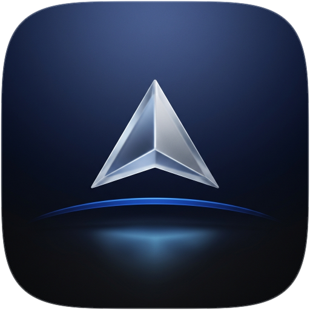

<div align="center">
  

  <h1>AntiRemote</h1>

  <p>
    <strong>Native SwiftUI iOS Client &amp; Self-Hosted Remote Bridge for Google Antigravity (<code>agy</code>)</strong>
  </p>

  <p>
    <a href="https://github.com/fishuvn/anti-ios/releases/latest">
      
    </a>
    <a href="https://github.com/fishuvn/anti-ios/actions/workflows/ios-ipa-release.yml">
      
    </a>
    
    
    
    
  </p>
</div>

---

Control your remote Google Antigravity backend (`agy`) from iPhone with Apple HIG native SwiftUI ergonomics, adaptive **iOS 26 Liquid Glass** (with automatic native **iOS 18** fallback), live WebSocket streaming, one-tap slash commands, workspace/diff inspection, and zero-dependency QR pairing.

## Languages & Tech Stack

| Component | Language | Frameworks & Tooling | Role |
| :--- | :--- | :--- | :--- |
| **iOS App (`ios/AntiRemote`)** | **Swift 6.2** | SwiftUI, Observation (`@Observable`), AVFoundation, Security (Keychain), XcodeGen | Native 4-tab iPhone/iPad control client (`iOS 18.0+`, Liquid Glass on `iOS 26+`) |
| **Core SDK (`ios/Packages/AntiCore`)** | **Swift 6.2** | SwiftPM, `URLSession` + `URLSessionWebSocketTask`, Swift Testing (`@Test`) | Sendable REST/WebSocket client, Keychain token store, pairing URI parser, offline Demo rig |
| **Remote Bridge ([`anti-bridge`](https://github.com/fishuvn/anti-bridge))** | **Rust + Tauri v2** | Separate repo (`fishuvn/anti-bridge`) — Native GUI (Tray / Menu Bar) + standalone CLI (`amd64` & `arm64`) | Cross-platform Windows / macOS / Linux bridge wrapping documented `agy` CLI without mutating CLI settings |
| **CI/CD & Changelog (`.github/`)** | **YAML + JavaScript** | GitHub Actions (`macos-15` Xcode 26.3, `ubuntu-latest`), `gh` CLI | Automated Bridge + Swift tests, `.ipa` build (signed/unsigned), auto Vietnamese GitHub Release |

## Adaptive iOS 18 & iOS 26 Liquid Glass UI

Built against the **Xcode 26 (iOS 26 SDK)** with `deploymentTarget: 18.0`:

- **iOS 26+**: Native floating Liquid Glass `TabView` (`.tabBarMinimizeBehavior(.onScrollDown)`), floating `GlassEffectContainer` composer & interactive slash-command pills (`.glassEffect`), `.safeAreaBar(edge: .top)` workspace pill, and `.buttonStyle(.glass)` / `.glassProminent` daemon controls. Content surfaces (messages, lists, code, diffs) stay solid semantic surfaces per Apple HIG.
- **iOS 18 – 25**: Standard Apple HIG translucent `.bar` composer with hairline divider, persistent bottom tab bar, semantic system surfaces, and `.bordered` / `.borderedProminent` controls.

## Repository Layout

- `assets/logo.png` — Continuous-squircle brand logo preview for docs & releases.
- `ios/` — Native SwiftUI iOS 18+ app (`Swift 6`, `XcodeGen` `project.yml`) + `Packages/AntiCore` Swift Package.
- `.github/workflows/ios-ipa-release.yml` & `.github/scripts/generate-vi-changelog.mjs` — Automated `.ipa` build and Vietnamese changelog release pipeline.
- `PRODUCT.md` & `DESIGN.md` — Product truth and Apple HIG design system contract.

> **Companion Remote Bridge:** Hosted in its own cross-platform Rust + Tauri v2 repository at [fishuvn/anti-bridge](https://github.com/fishuvn/anti-bridge) (Windows / macOS / Linux `amd64` & `arm64` Desktop Tray/Menu Bar GUI + standalone headless CLI).

## 1. Run the Companion Remote Bridge (`anti-bridge`)

Download the prebuilt GUI installer (`.exe`, `.dmg`, `.deb` / `.AppImage`) or standalone CLI binary from [fishuvn/anti-bridge Releases](https://github.com/fishuvn/anti-bridge/releases/latest), then run:

```bash
# Headless CLI (Windows / macOS / Linux, amd64 & arm64)
anti-bridge --workspace /path/to/your/project
```

- Automatically uses `agy` when installed on `PATH` (`--adapter auto`), or falls back cleanly to `--adapter mock` for local testing.
- Prints a one-time pairing code and scannable terminal QR code (`antiremote://pair?url=...&code=...`).
- For public/WAN access, run over Tailscale or pass `--tls-cert cert.pem --tls-key key.pem` for HTTPS/WSS.

## 2. Install or Build the iOS App

### Option A — Download Prebuilt `.ipa` from GitHub Releases
Download the latest `.ipa` from [Releases](https://github.com/fishuvn/anti-ios/releases/latest) and install via **AltStore**, **SideStore**, **Sideloadly**, **TrollStore**, or resign in **Xcode**.

> To enable automatic signed `.ipa` exports in GitHub Actions, add repository secrets: `APPLE_CERT_BASE64`, `APPLE_CERT_PASSWORD`, `APPLE_PROVISIONING_PROFILE_BASE64`, and `APPLE_TEAM_ID`.

### Option B — Build Locally on macOS (Xcode 16+ / Xcode 26+)

```bash
# Run pure-Swift core unit tests (Swift Testing)
cd ios/Packages/AntiCore
swift test

# Generate Xcode project and open
cd ../..
brew install xcodegen   # once
xcodegen generate
open AntiRemote.xcodeproj
```

1. Select an iPhone simulator (or physical iPhone) and press **Run**.
2. The app launches straight into **Demo Rig** so every tab, slash command, streaming response, file viewer, and git diff works immediately.
3. Tap the top-left host pill (or **Settings -> Pair Remote Machine via QR**) to scan the terminal QR printed by `antiremote-bridge`.

## Security Controls

- Bearer tokens stored exclusively in iOS Keychain (`kSecAttrAccessibleAfterFirstUnlockThisDeviceOnly`) and verified with `crypto.timingSafeEqual` on the bridge.
- Pairing codes are single-use, expire after 10 minutes, and rate-limited per IP.
- Workspace file/git routes verify canonical `realpath` boundaries and reject `..` traversal and symlink escapes.
- `NSAppTransportSecurity` allows only local network HTTP (`NSAllowsLocalNetworking = true`), preserving ATS HTTPS enforcement on public hosts.
